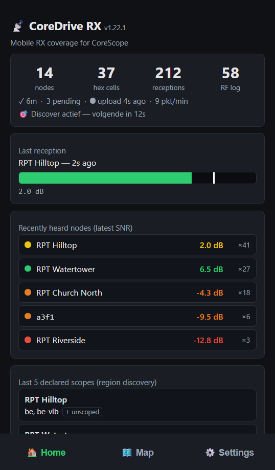
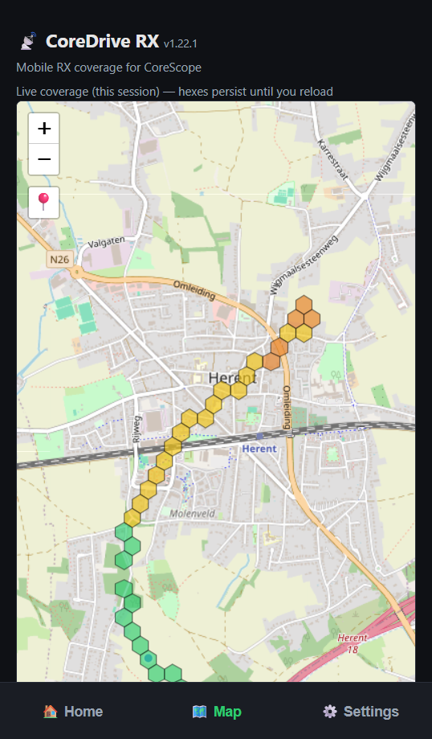
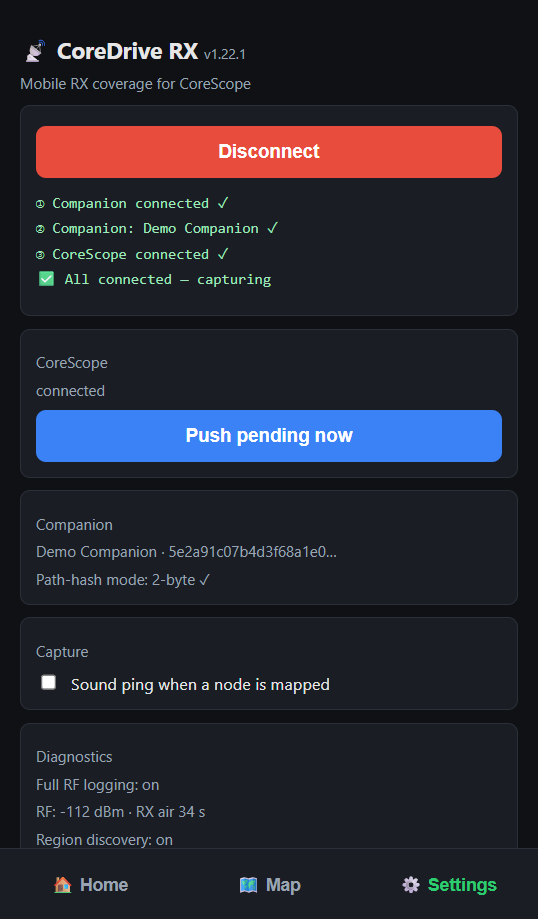
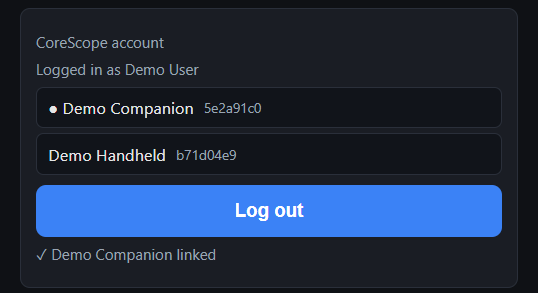

# CoreDrive RX user guide

For people who drive or walk around with a companion radio to map coverage. Hosting the app
yourself is covered in the [README](../README.md#self-hosting-for-a-corescope-sysop).

## What it is

CoreDrive RX is a coverage mapper. Your MeshCore companion connects to the app over Bluetooth.
The app records which nodes your radio hears **directly**, with the signal strength (SNR/RSSI),
tags each reception with your phone's GPS position, and uploads it to CoreScope. CoreScope turns
that into per-node coverage hexes on its Reach page.

It records only what your own radio heard in one hop: a node's zero-hop advert, or the last
repeater that forwarded a flood packet to you. Nodes further up the path are ignored, so the map
shows real direct links and nothing inferred.

## What you need

- A MeshCore **companion** radio with Bluetooth (BLE) firmware. **v1.16.0 or newer** gets every
  feature; see [Firmware](#firmware) for what older versions miss.
- A browser with Web Bluetooth:
  - **Android:** Chrome.
  - **iPhone / iPad:** the [Bluefy](https://apps.apple.com/app/bluefy-web-ble-browser/id1492822055)
    browser. Safari and the other iOS browsers cannot do Web Bluetooth.
  - **Desktop:** Chrome or Edge (handy for testing).
- Location permission for the page, and a GPS fix. Without a position nothing is recorded.
- A mobile data connection now and then. Receptions are stored on the phone and uploaded when
  there is a connection, so dead zones are fine.

## Can I still chat?

With the stock companion firmware, not on the same companion at the same time. It accepts one
Bluetooth connection, and while CoreDrive RX holds it, the MeshCore app cannot connect. Press **Disconnect** in Settings and
the MeshCore app can connect again. To map and chat at once you need a second companion.

A companion with a screen (for example a T-Deck) still shows incoming direct messages on its own
display while CoreDrive RX is connected, but without its notification sound. Replying needs the
MeshCore app, or a standalone firmware with a keyboard UI.

Users report that this works with [Wadamesh](https://wadamesh.com/), a MeshCore firmware with
on-device chat for the LilyGo T-Deck and other boards. On a LilyGo T-Deck one user runs three
at once: CoreDrive RX over Bluetooth, the Kiekr app over Wi-Fi, and chat on the device's own
screen and keyboard. This was not tested by the CoreDrive RX project.

Messages are not lost meanwhile: the stock companion keeps up to 16 of them until the MeshCore app
connects again (when it is full, the oldest channel messages go first). To know when a direct
message arrives, tick **Notify when a direct message waits on the companion** in Settings (off
by default, optionally with a sound). A blue note on Home then counts them; tap it to dismiss.
Channel messages, including the `#coredrive` pings of other users, are not counted. Room-server
posts arrive like direct messages and are counted. CoreDrive RX never reads or removes the
messages.

## Does it transmit?

Yes, a little. It is not a pure listener:

- **Discover:** a zero-hop "who is there" request, at most every 30 seconds. It waits 15 seconds
  after any other traffic it hears, and stops while you are stationary.
- **Region questions:** a short request to repeaters it currently hears, asking which regions they
  serve. Limited per repeater so it stays within what the repeater firmware allows.
- **Uplink ping** (only when the deployment turns it on, as rx.on8ar.eu does): a channel message
  `cdrx <random tag>` on the `#coredrive` channel. At most one per minute, at least 250 m apart,
  50 per hour, and a spot already pinged in the last 7 days is skipped. It shows which repeaters
  and observers pick you up. On first use the app adds `#coredrive` to a free channel slot on your
  companion; it never overwrites a slot in use, and with no free slot pinging stays off.

Your position never goes over the mesh. It is only sent to CoreScope over the internet.

## Getting started

1. Open the app in Chrome (Android) or Bluefy (iOS). On Android you can install it to the home
   screen from the browser menu.
2. The app opens on **Settings**. Tap **Connect companion (BLE)** and pick your companion in the
   Bluetooth dialog.
3. Allow location access when asked.
4. The connection steps show their progress: companion, companion ID, CoreScope. Once connected
   the app switches to **Home**.
5. Start moving. The screen stays awake while capturing.

### Android app

Besides the web app there is an Android app. It works the same, but it does not need Chrome and
keeps capturing in the background. On first start it asks for the address of your CoreDrive RX
deployment: see the next section.

### Choosing a deployment (Android app)

The web app always uploads to the CoreScope it came from. The Android app comes from Google Play
and does not know which CoreScope you use, so on first start you tell it, under **Settings >
Deployment**:

1. On a computer or another phone, open the CoreScope your MeshCore community uses in a browser.
2. In its menu, open **Coverage**. That page shows a QR code with an address under it.
3. In the app, tap **Scan QR code** and point the camera at it. With only one phone, type the
   address under the QR code into the field and tap **Use this deployment**.

The app checks that address before it switches. Scanning the deployment you already use changes
nothing; switching to another one while connected asks first, because the app restarts and the
companion disconnects.

No **Coverage** in the menu, or no QR code on that page? Then that CoreScope does not take
CoreDrive data. Ask whoever runs it.

Use one of the two, not both. Only one app at a time can hold the Bluetooth link to the
companion, and each keeps its own queue and login. If you installed the web app to the home
screen earlier, remove that icon after installing the Android app: long-press it and choose
uninstall or remove. The web app is called **CoreDrive RX Web** on the home screen, the Android
app **CoreDrive RX**. A web app installed before that rename may keep its old name until Chrome
refreshes it, so both icons can read "CoreDrive RX" for a while.

Google Play updates apps by itself, often only a day later, and without a message. So the app
checks at start: when a newer version exists, a blue note above the tabs says so, on every screen. Tap it to update
through Google Play. An APK from GitHub gets the same note, with a link to the releases page.

Some phones close apps in the background to save battery, even while the capture notification
shows. A OnePlus did that during a test walk, and capture stopped without a warning. Before you
drive, open the phone's **Settings > Apps > CoreDrive RX > Battery** and choose **Unrestricted**,
or turn off battery optimisation and allow background activity. The names differ per brand;
[dontkillmyapp.com](https://dontkillmyapp.com) shows them for yours. The app shows this once,
before your first **Connect**.

## The screens

The screenshots below were made with made-up demo data, not a real drive.

**Home**

- Counters: distinct nodes, hex cells covered, total receptions, and "RF log" (receptions kept for
  diagnostics only) when the deployment has full RF logging on.
- Status strip: GPS accuracy, receptions waiting to upload ("pending"), upload health and the age
  of the last upload, packets per minute.
- **Last reception:** SNR of the latest reception on a meter with a peak marker.
- **Recently heard nodes** with their latest SNR.
- A red warning when receptions are queued but not uploading, and a "Paused, stationary" line when
  you stand still (see below).
- **Last 5 declared scopes:** the regions the most recently asked repeaters said they serve.

**Map**

The cells you covered in this session, coloured by best SNR (green strong, yellow, orange, red
weak). They clear when you reload the page. The pin button re-centres on your position.
Map data © [OpenStreetMap](https://www.openstreetmap.org/copyright) contributors.

**Settings**

- **Connect / Disconnect.**
- **CoreScope:** broker status and **Push pending now** to upload the queue immediately.
- **CoreScope account** (only on deployments with user accounts), see
  [CoreScope account](#corescope-account).
- **Companion:** name and details of the connected radio.
- **Capture:** *Sound ping when a node is mapped* gives a short beep per mapped reception, so you
  do not have to look at the phone.
  *Notify when a direct message waits on the companion* (and *with a sound*) shows the message note on
  Home, see [Can I still chat?](#can-i-still-chat).
- **Diagnostics:** debug log, **Share / mail debug log**, and **Uplink ping now** to send one ping
  by hand.

## CoreScope account

Only shown when the CoreScope you upload to has user accounts. Log in with your CoreScope email
and password. The app keeps only a device token, which shows under **Devices** on your account
page in CoreScope and can be revoked there.

Every companion you connect while logged in is linked to your account: the companion signs a
challenge from the server with its own key, so only someone holding the radio can link it. Linked
companions show in the card (the connected one marked ●) and under **Companions** on your
CoreScope account page. Coverage they collect is attributed to you.

Some deployments only accept data from linked companions. There the app keeps an unlinked
companion's receptions on the phone ("Log in to contribute your data, N waiting") and uploads them
once it is linked, so nothing is lost. A companion whose firmware cannot sign shows "update it to
link".

## Seeing your results

Coverage is shown in CoreScope, not in this app (the Map tab only shows the current session). For
rx.on8ar.eu that is [analyzer.on8ar.eu](https://analyzer.on8ar.eu); other deployments use their
own CoreScope.

1. Open **Nodes** and pick a node you drove past.
2. Press **Reach**.
3. Tick **coverage** ("where clients heard it"). The hexes are where clients like yours heard that
   node.

## Firmware

Features check the companion's firmware on connect and switch themselves off when it is too old.
The debug log says why.

| Feature | Companion firmware |
|---|---|
| Coverage capture | stock BLE companion firmware |
| Region questions to repeaters | v1.16.0+ |
| Uplink ping with a region scope (rx.on8ar.eu uses one) | v1.10.0+ |
| Uplink ping using the companion's own default scope | v1.14.0+ |
| Uplink ping explicitly unscoped | v1.16.0+ |

On connect the app also switches the companion to 2-byte path hashes if it was on 1-byte, because
1-byte IDs collide too often to be attributed. That setting stays on the radio.

## Good to know

- **Keep the app in front.** The app keeps the screen awake by itself. If you switch to another
  app or lock the phone, the browser slows the page down and GPS updates can stall. Receptions are
  then stamped with the last position the phone reported, which can be well behind where you
  are. Use a phone holder and leave it on the CoreDrive RX screen.
- **Standing still pauses capture.** After 5 minutes within 75 m of the same spot the app stops
  recording and stops sending discover requests. It resumes by itself as soon as you move.
- **Offline is fine.** Receptions are kept on the phone and uploaded later. They are only removed
  once the server has confirmed them.
- **More than one companion:** receptions are uploaded only while the companion that captured them
  is connected. Another companion's backlog waits until that one is connected again.
- **Phone GPS, not companion GPS.** The position always comes from the phone.

## When something is wrong

| Symptom | Check |
|---|---|
| "Web Bluetooth isn't available" | Wrong browser: use Chrome on Android, Bluefy on iOS. |
| Companion not in the Bluetooth list | Disconnect it in the MeshCore app first, or close that app. |
| Nothing is recorded | GPS fix (Home status strip), and whether you are paused as stationary. |
| Android app stopped while the screen was off | Battery setting for CoreDrive RX: **Unrestricted** (see [Android app](#android-app)). |
| Pending count keeps growing | Mobile data, then **Push pending now** in Settings. |
| Anything else | **Share / mail debug log** in Settings and send it to the operator of your deployment. |
